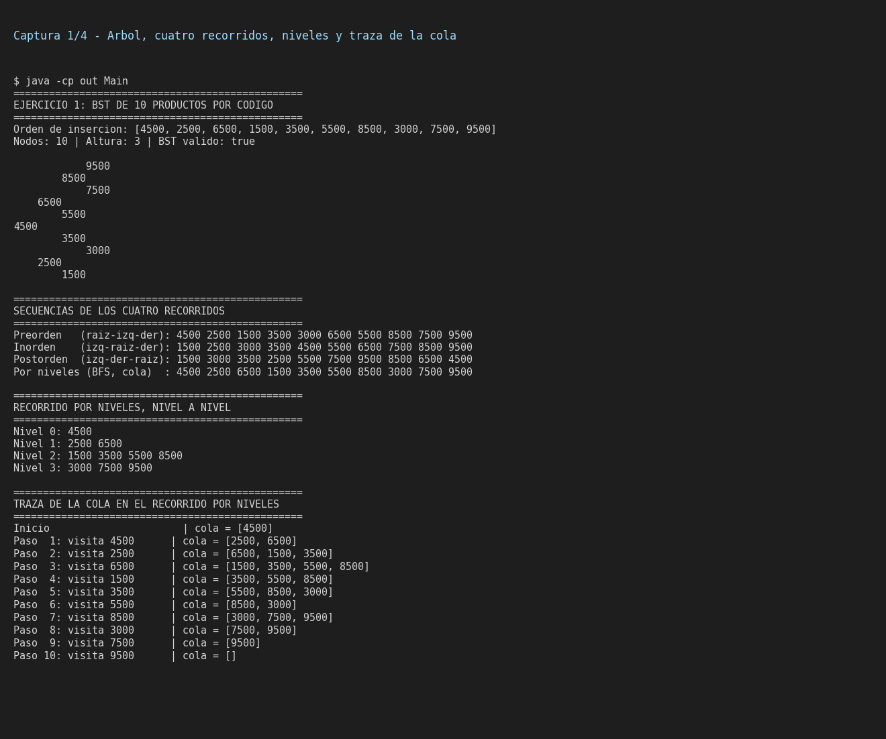
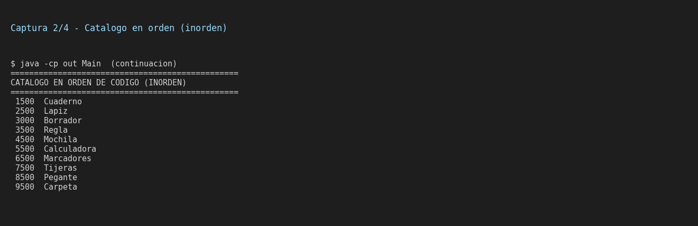
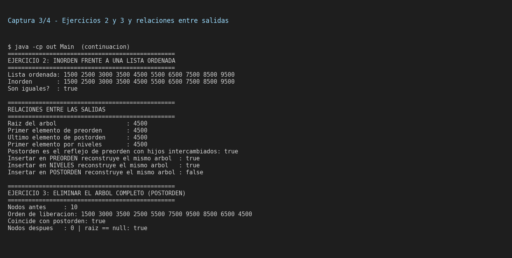
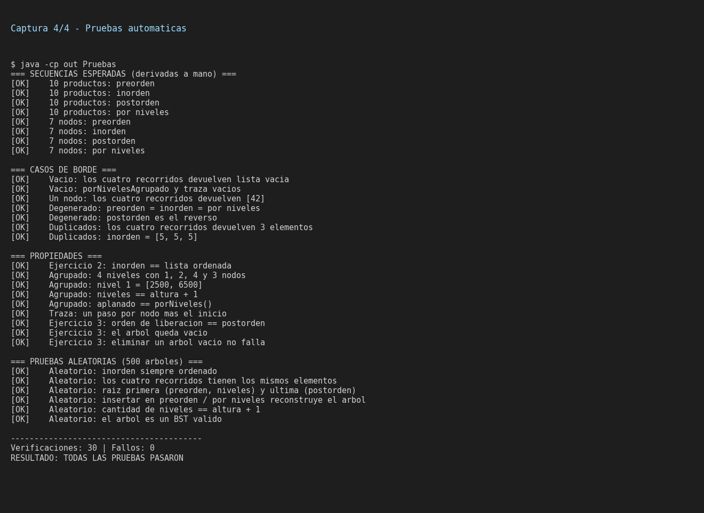

# Guía 6 – Recorridos en árboles binarios

**Asignatura:** Estructura de Datos II  
**Programas:** Ingeniería de Software – Ingeniería de Sistemas · **Semestre:** IV  
**Ecosistema:** Java / GitHub (VS Code)

## Objetivo

Implementar y comparar los recorridos **Preorden**, **Inorden**, **Postorden** y **por niveles** sobre un Árbol Binario de Búsqueda (BST).

El proyecto usa el BST de las guías anteriores (inserción, búsqueda y eliminación) y le agrega los cuatro recorridos.

## Estructura del proyecto

```text
06-recorridos/
├── src/
│   ├── NodoArbol.java    # nodo genérico NodoArbol<T>
│   ├── ArbolBST.java     # BST + preorden, inorden, postorden, porNiveles
│   ├── Main.java         # ejercicios, secuencias y análisis
│   └── Pruebas.java      # pruebas automáticas
├── docs/
│   ├── diagrama_arbol_10_productos.png   # el árbol con códigos y nombres
│   ├── diagrama_preorden.png             # un diagrama por recorrido
│   ├── diagrama_inorden.png
│   ├── diagrama_postorden.png
│   ├── diagrama_por_niveles.png
│   ├── diagrama_recorridos.png           # los cuatro juntos
│   ├── secuencias.csv            # tabla de secuencias obtenidas
│   └── generar_*.py              # regeneran los PNG (matplotlib)
├── capturas/                     # capturas de la ejecución
├── salida/
│   ├── salida_main.txt
│   └── salida_pruebas.txt
└── README.md
```

## Cómo compilar y ejecutar

Desde la carpeta `06-recorridos`:

```bash
javac -encoding UTF-8 -d out src/*.java
java -cp out Main        # ejercicios y secuencias
java -cp out Pruebas     # pruebas automáticas (código de salida 1 si algo falla)
```

## Implementación

| Método | Tipo | Cómo funciona |
|---|---|---|
| `preorden()` | DFS recursivo | visita **raíz**, luego izquierda y derecha |
| `inorden()` | DFS recursivo | izquierda, **raíz**, derecha |
| `postorden()` | DFS recursivo | izquierda, derecha y al final la **raíz** |
| `porNiveles()` | BFS con `Queue` | cola FIFO: sale un nodo y entran sus hijos |

Diferencia con el código base de la guía: en vez de imprimir dentro del recorrido, cada método **devuelve una `List<Integer>`** con la secuencia. Así se puede imprimir, comparar con otra lista y probar automáticamente. También hay `porNivelesAgrupado()` (una lista por nivel) y `trazarPorNiveles()` (estado de la cola en cada paso).

## Ejercicio 1 – Árbol de 10 productos por código

Orden de inserción: `4500, 2500, 6500, 1500, 3500, 5500, 8500, 3000, 7500, 9500` (10 nodos, altura 3).

```text
              4500
           /        \
        2500        6500
        /  \        /   \
     1500  3500  5500   8500
           /            /  \
        3000         7500  9500
```


### Secuencias obtenidas

| Recorrido | Secuencia |
|---|---|
| Preorden (raíz-izq-der) | `4500 2500 1500 3500 3000 6500 5500 8500 7500 9500` |
| Inorden (izq-raíz-der) | `1500 2500 3000 3500 4500 5500 6500 7500 8500 9500` |
| Postorden (izq-der-raíz) | `1500 3000 3500 2500 5500 7500 9500 8500 6500 4500` |
| Por niveles (BFS) | `4500 2500 6500 1500 3500 5500 8500 3000 7500 9500` |

(Los mismos datos están en [`docs/secuencias.csv`](docs/secuencias.csv).)

Cada recorrido sobre el mismo árbol (el número rojo indica el orden de visita):

**Preorden**


**Inorden**


**Postorden**


**Por niveles** (las franjas marcan cada nivel del árbol)


**Comparación de los cuatro en una sola figura**


### Recorrido por niveles

| Nivel | Nodos |
|---|---|
| 0 | `4500` |
| 1 | `2500 6500` |
| 2 | `1500 3500 5500 8500` |
| 3 | `3000 7500 9500` |

Traza de la cola (`Queue`): en cada paso sale el nodo más antiguo y entran sus hijos al final.

| Paso | Visita | Cola después del paso |
|---|---|---|
| Inicio | – | `[4500]` |
| 1 | 4500 | `[2500, 6500]` |
| 2 | 2500 | `[6500, 1500, 3500]` |
| 3 | 6500 | `[1500, 3500, 5500, 8500]` |
| 4 | 1500 | `[3500, 5500, 8500]` |
| 5 | 3500 | `[5500, 8500, 3000]` |
| 6 | 5500 | `[8500, 3000]` |
| 7 | 8500 | `[3000, 7500, 9500]` |
| 8 | 3000 | `[7500, 9500]` |
| 9 | 7500 | `[9500]` |
| 10 | 9500 | `[]` |

Como la cola es FIFO, todos los nodos de un nivel salen antes que los del siguiente. Por eso la secuencia por niveles coincide con la lectura del árbol por filas.

## Ejercicio 2 – Inorden frente a una lista ordenada

```text
Lista ordenada: 1500 2500 3000 3500 4500 5500 6500 7500 8500 9500
Inorden       : 1500 2500 3000 3500 4500 5500 6500 7500 8500 9500
Son iguales?  : true
```

Son idénticas. En un BST todo lo que está a la izquierda de un nodo es menor y todo lo que está a la derecha es mayor o igual, así que "izquierda, raíz, derecha" visita las claves de menor a mayor. Esto también sirve como prueba de que el árbol cumple la propiedad BST: si el inorden no saliera ordenado, el árbol estaría mal construido.

## Ejercicio 3 – ¿Qué recorrido usar para eliminar un árbol completo?

**Postorden.** Un nodo solo se libera después de haber liberado a sus dos hijos.

- Con **preorden** se liberaría el padre primero. Si al hacerlo se pierden las referencias a los hijos, esos subárboles quedarían sin liberar (fuga de memoria en lenguajes sin recolector, como C/C++).
- Con **inorden** la raíz se libera en medio del recorrido y luego habría que seguir hacia el hijo derecho a través de un nodo que ya no existe.
- Con **postorden** el padre es lo último que se toca, así que nunca se usa una referencia a un nodo ya liberado y no hace falta guardar punteros auxiliares.

En Java el recolector de basura libera la memoria solo, pero el método `eliminarTodoPostorden()` muestra el orden correcto: desconecta cada nodo de sus hijos después de procesarlos y deja la raíz en `null`.

```text
Orden de liberación: 1500 3000 3500 2500 5500 7500 9500 8500 6500 4500
Coincide con postorden: true
Nodos después   : 0 | raíz == null: true
```

## Relaciones entre las salidas (interpretación)

- **La raíz (`4500`)** es el primer elemento de preorden y de por niveles, y el **último** de postorden. En inorden aparece en el medio, separando los menores de los mayores (`1500 … 3500` | `4500` | `5500 … 9500`).
- **Postorden es el espejo de preorden con los hijos intercambiados:** invertir "raíz-derecha-izquierda" da exactamente la secuencia de postorden (comprobado en `Main`).
- **Preorden y por niveles reconstruyen el árbol.** Si se insertan en un BST vacío los datos en esa secuencia, se obtiene el mismo árbol: en ambos, cada padre aparece antes que sus hijos. Insertar en **postorden** no lo reconstruye (la raíz quedaría de última) y en **inorden** (datos ordenados) produce una cadena degenerada, como se vio en la Guía 4.
- **Los cuatro recorridos contienen los mismos 10 nodos**, solo cambia el orden de visita.
- **Preorden es "de arriba hacia abajo", postorden es "de abajo hacia arriba"** e inorden recorre de izquierda a derecha. Por niveles recorre por profundidad creciente, no por ramas.

## Casos de uso apropiados para cada recorrido

| Recorrido | Caso de uso | Por qué es el apropiado |
|---|---|---|
| **Preorden** | Copiar o guardar un árbol (serializarlo) para reconstruirlo igual después; mostrar una jerarquía como carpetas y subcarpetas | El padre se procesa antes que sus hijos, así que al reconstruir cada nodo ya tiene su lugar. |
| **Inorden** | Listar el catálogo de productos ordenado por código; verificar que un árbol sea BST; buscar el menor/mayor o un rango de claves | En un BST produce las claves ordenadas sin tener que ordenar aparte. |
| **Postorden** | Eliminar o liberar un árbol completo; calcular el tamaño total de una carpeta (primero sus contenidos); evaluar expresiones aritméticas (notación postfija) | Los hijos se procesan antes que el padre, que necesita su resultado o no debe liberarse antes. |
| **Por niveles** | Hallar el nodo más cercano a la raíz que cumple una condición; mostrar un organigrama por jerarquías; calcular la altura o el ancho de cada nivel; algoritmos de camino más corto (BFS) | Recorre por profundidad creciente, así que lo más cercano a la raíz aparece primero. |

## Pruebas de ejecución

`Pruebas.java` realiza **30 verificaciones** y todas pasan (ver [`salida/salida_pruebas.txt`](salida/salida_pruebas.txt)):

- Secuencias esperadas de los cuatro recorridos en el árbol de 10 productos y en uno de 7 nodos, derivadas a mano.
- Casos de borde: árbol vacío, un solo nodo, árbol degenerado y claves duplicadas.
- Inorden igual a la lista ordenada, niveles agrupados (1, 2, 4 y 3 nodos), traza de la cola y eliminación completa en postorden.
- 500 árboles aleatorios que comprueban propiedades válidas para cualquier BST: inorden ordenado, mismos elementos en los cuatro recorridos, raíz primera/última según el recorrido, reconstrucción con preorden y por niveles, y niveles = altura + 1.

### Capturas de ejecución

Salida de `Main` y de `Pruebas`:






## Complejidad

| Recorrido | Tiempo | Espacio adicional |
|---|---|---|
| Preorden, inorden, postorden | O(n): cada nodo se visita una vez | O(h): la pila de recursión llega hasta la altura del árbol |
| Por niveles | O(n) | O(a): la cola guarda como máximo los nodos del nivel más ancho |

En un árbol degenerado, `h = n`, y la recursión de los recorridos en profundidad puede llegar a `n` llamadas encadenadas.
